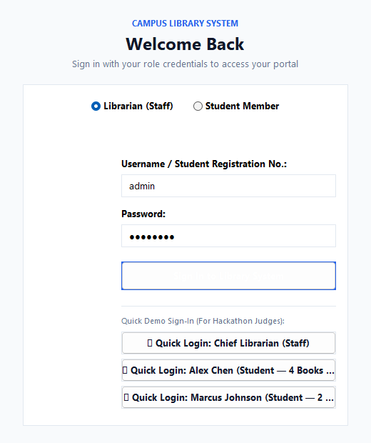
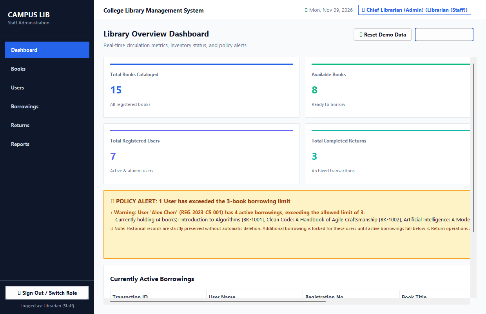
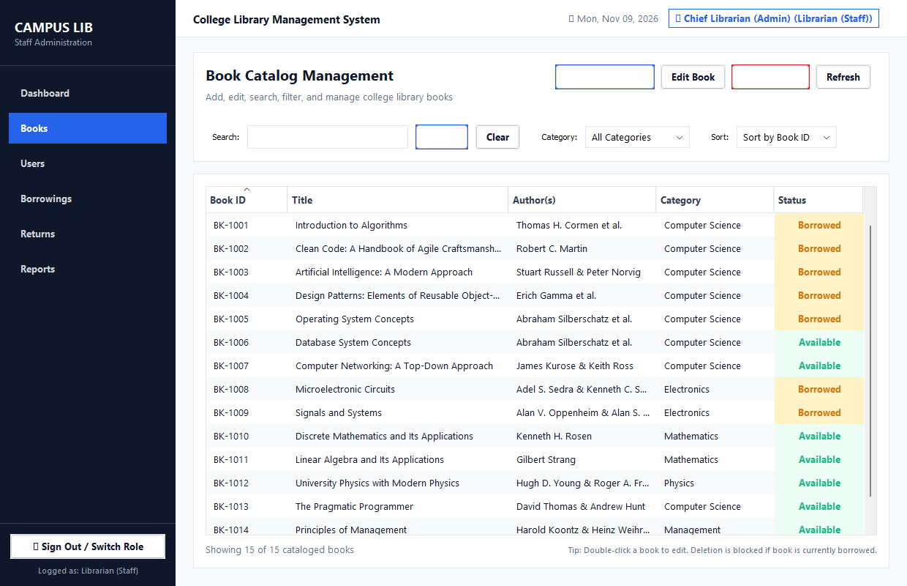
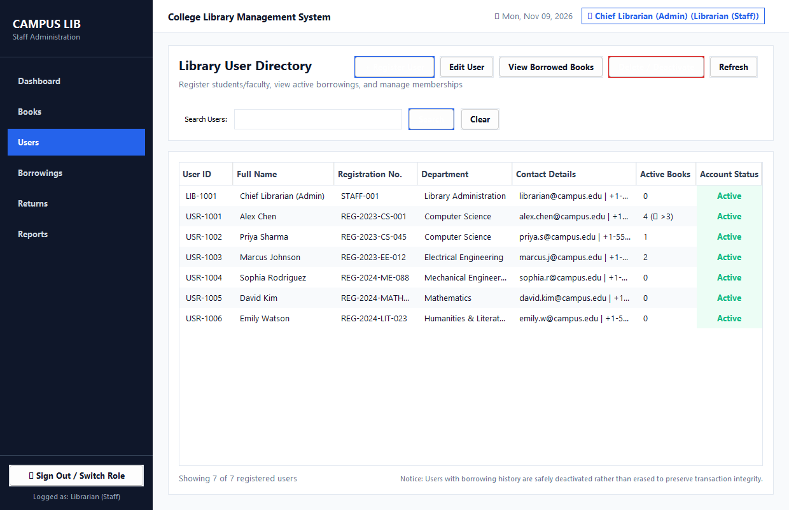
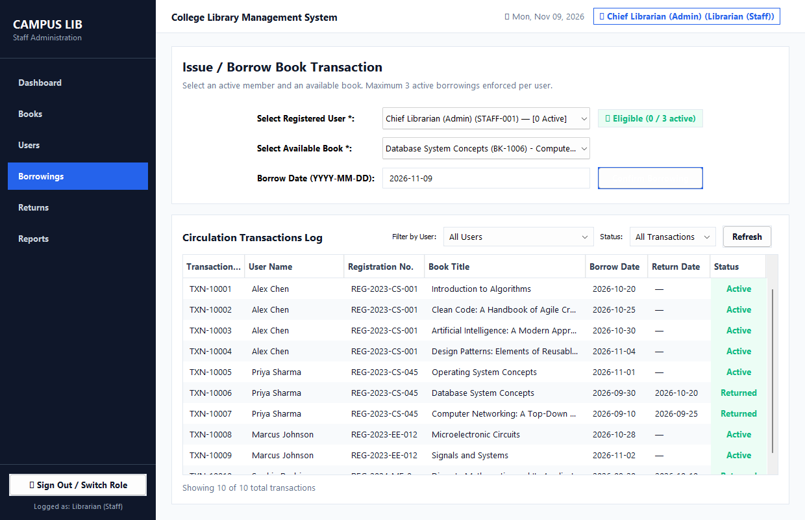
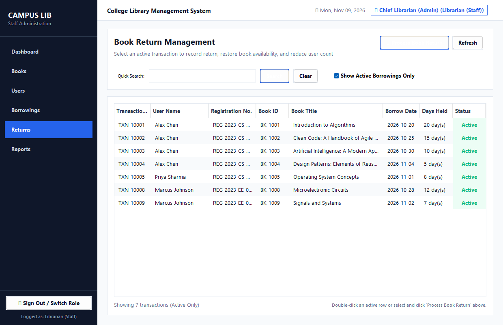
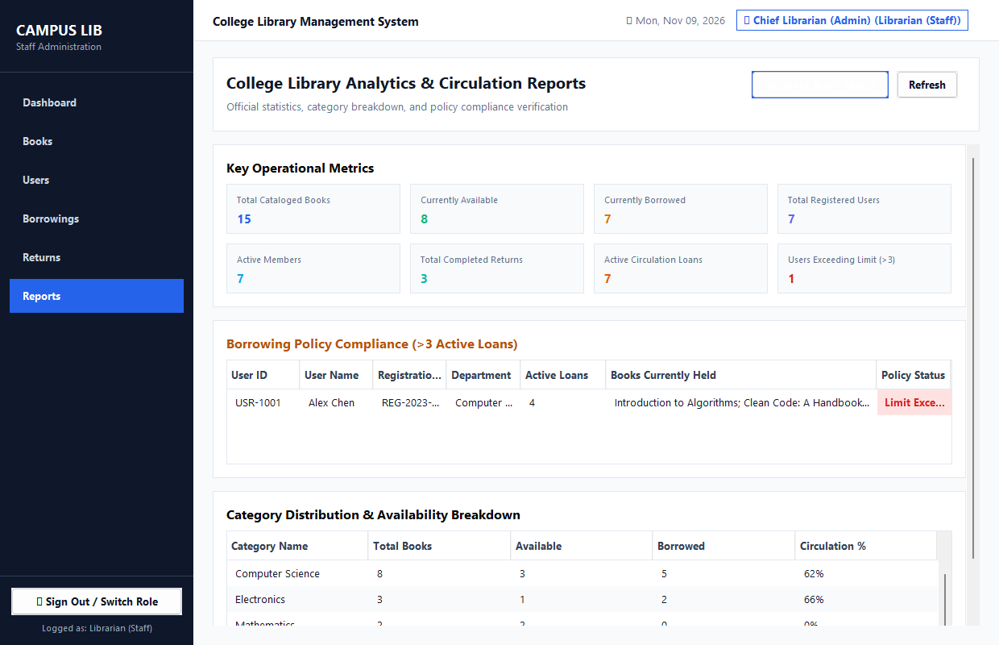
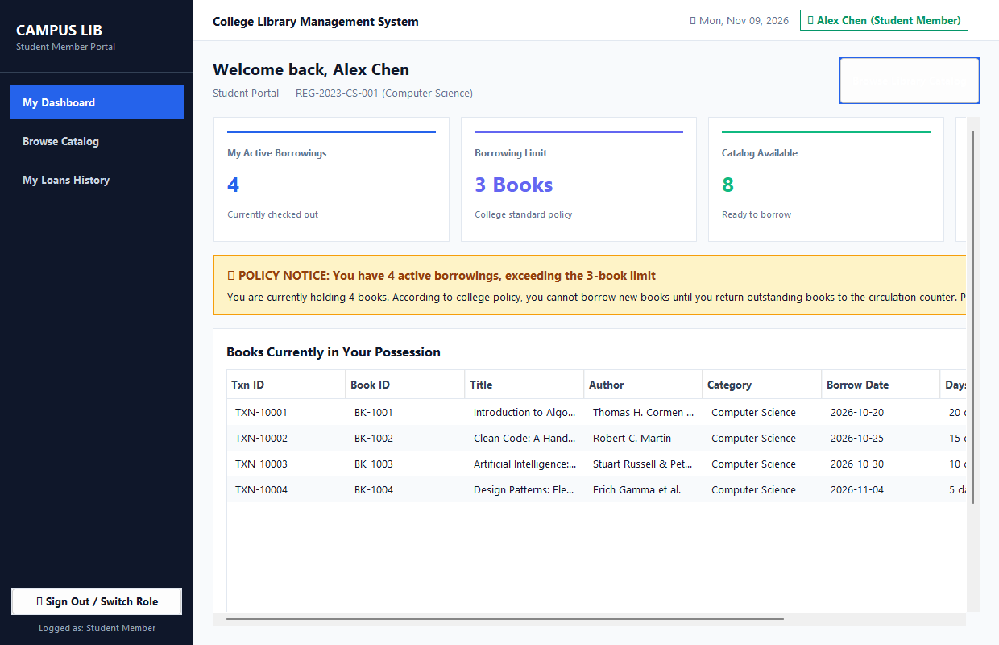

# College Library Management System

A desktop application designed for college librarians to manage book catalogs, student memberships, borrowing transactions, and return workflows. Built exclusively with standard **Java SE (Swing & AWT)** with persistent storage, strict three-book borrowing limits, role-based access control, and automated compliance auditing.

---

## ⚡ Quick Start: Simple Commands

Run these simple 1-line commands directly in your terminal:

| Action | Simple Command | Description |
|---|---|---|
| **1. Compile / Build** | `build.bat` | Compiles all source files into the `bin/` directory |
| **2. Run Application** | `run.bat` | Launches the Java Swing Desktop GUI window |
| **3. Run Verification Tests** | `test.bat` | Runs all 38 automated requirement test assertions |
| **4. Package Executable JAR**| `package.bat` | Generates double-clickable `LibraryManagementSystem.jar` |

> **Pro Tip**: You can also launch the application directly by double-clicking [`LibraryManagementSystem.jar`](LibraryManagementSystem.jar) or by running:
> ```cmd
> java -jar LibraryManagementSystem.jar
> ```

---

## 🔑 Default Login Credentials

| Role | Username / Identifier | Password | Access Privileges |
|---|---|---|---|
| **Chief Librarian (Staff)** | `admin` *(or `librarian`)* | `admin123` | **Full Administrative Access**<br>• Add, edit, delete books<br>• Register, edit, deactivate users<br>• Issue borrowing loans<br>• Process book returns<br>• Institutional audit reports & demo data reset |
| **Student (Alex Chen)** | `REG-2023-CS-001` *(or `alex`)* | `student123` | **Student Member Portal**<br>• Holds **4 active books** (demonstrates Requirement 8 limit violation)<br>• Inspect held books, borrow limit meter, catalog browser |
| **Student (Marcus Johnson)** | `REG-2023-EE-012` *(or `marcus`)* | `student123` | **Student Member Portal**<br>• Holds **2 active books** (eligible to borrow 1 more) |
| **Student (Priya Sharma)** | `REG-2023-CS-045` *(or `priya`)* | `student123` | **Student Member Portal**<br>• Holds 1 active loan, 2 completed returns |

*(For live presentations, the login screen includes **1-Click Quick Demo Sign-In** buttons for instant persona switching without typing).*

---

## 📸 Live Demonstration Walkthrough

Below is a visual walkthrough demonstrating each major screen and requirement.

### 1. Role-Based Login & Quick Sign-In
Provides distinct access levels for administrative staff and students, with single-click demo shortcuts for live judging.



- **Staff vs Student toggle**: Select between administrative staff and student membership.
- **Flexible identifier**: Students can enter their Student Registration Number (e.g., `REG-2023-CS-001`) or username (`alex`).
- **Quick Demo Sign-In**: Instant 1-click buttons pre-configured for **Chief Librarian**, **Alex Chen (4 loans)**, and **Marcus Johnson (2 loans)**.

---

### 2. Main Librarian Dashboard (Requirement 3 & 8)
Presents real-time operational metrics, circulation logs, and policy compliance alerts.



- **6 KPI Stat Cards**: Total Cataloged Books (15), Available Copies (8), Currently Borrowed (7), Total Users (7), Completed Returns (3), and Limit Violations (1).
- **Requirement 8 Policy Alert Banner**: Automatically detects and highlights users exceeding the 3-book limit:
  > *"⚠️ POLICY ALERT: 1 User has exceeded the 3-book borrowing limit"*  
  > *"• Warning: User 'Alex Chen' (REG-2023-CS-001) has 4 active borrowings, exceeding the allowed limit of 3."*
- **Preservation Guarantee**: Pre-existing records are safely loaded and displayed without automatic deletion.
- **Active Loans Table**: Live monitor of all checked-out books with borrower details and borrow dates.
- **1-Click Demo Reset**: `↺ Reset Demo Data` restores the initial test state in one click between judging rounds.

---

### 3. Book Catalog Management (Requirement 4)
Full CRUD lifecycle management with automatic sequential IDs and active loan deletion protection.



- **Auto-Generated IDs**: Sequential IDs (`BK-1001`, `BK-1002`, etc.) generated automatically.
- **Live Search & Filter**: Search by title, author, or book ID, and filter by category (Computer Science, Electronics, Mathematics, etc.).
- **Multi-Attribute Sorting**: Sort by Book ID, Title, Author, or Category.
- **Safety Lock on Deletion**: Prevents deletion of books currently borrowed in an active transaction, displaying a clear explanatory dialog:
  > *"Cannot delete book 'Introduction to Algorithms' (ID: BK-1001) because it is currently borrowed by an active transaction."*

---

### 4. Member / User Directory (Requirement 5)
Student and faculty directory management with duplicate registration prevention and historical record preservation.



- **Registration Fields**: Full Name, Student Registration Number, Department, and Contact Info.
- **Uniqueness Check**: Validates and rejects duplicate registration numbers.
- **Safe Deactivation / History Preservation**: Users with transaction history are safely deactivated (`[Deactivated]`) rather than erased, permanently safeguarding circulation records.
- **Loan Inspector**: One-click modal to inspect all books currently held by any selected student.

---

### 5. Issue Borrowing & Three-Book Limit Enforcement (Requirement 6 & 7)
Circulation desk interface with real-time limit checking and strict business-logic rejection.



- **Dropdown Selectors**: Fast selection of active registered members and currently available catalog books.
- **Real-Time Limit Badge**: Dynamic indicator next to user selection:
  - `✓ Eligible (N / 3 active)` — Green badge when under limit.
  - `⚠️ Borrowing Blocked (3 / 3 active)` — Amber badge when at maximum.
  - `⚠️ Borrowing Blocked (4 / 3 active)` — Red badge when exceeding limit.
- **Strict Enforcement**: If active borrowings $\ge 3$, the transaction is strictly rejected:
  > *"Borrowing rejected: This user has already borrowed the maximum of 3 books."*
- **Immediate State Synchronization**: Marks transaction `ACTIVE`, marks the book `BORROWED`, and updates dashboard counters in real time.

---

### 6. Book Return Management (Requirement 9)
Streamlined return workflow designed for circulation librarians.



- **Active Loan Filter**: Instantly displays all currently borrowed books with borrower details and duration held.
- **Process Return**: One-click return confirmation dialog recording return date.
- **Inventory Restoration**: Restores book status to `AVAILABLE`, decrements borrower's active count, and immediately updates dashboard statistics.
- **History Preservation**: Preserves the complete transaction log as `RETURNED` for auditing. Prevents double-returning transactions.

---

### 7. Circulation Analytics & Institutional Audit Reports (Requirement 12)
Aggregated metrics, category distribution, policy audit, and official export tools.



- **Key Operational Metrics**: Books in circulation, available inventory, active member counts, and policy violation counts.
- **Category Breakdown**: Tabular analysis of inventory distribution, available vs. borrowed copies, and circulation rate percentage per subject.
- **Policy Compliance Table**: Detailed list of users holding $>3$ books with titles and departments.
- **Audit Report Generator**: Generates formatted institutional audit documents with one-click **"Export to File (.txt)"** and **"Copy Report Text"** for official documentation.

---

### 8. Student Member Self-Service Portal
Restricted self-service interface customized for student users.



- **Personal Dashboard**: Displays active loans count, 3-book limit meter, and personal loan warnings.
- **Held Books Inspector**: Lists all books currently in the student's possession with checkout dates and days held.
- **Browse Catalog**: Students can browse and search the library catalog to find available books; catalog modification actions (Add, Edit, Delete) are locked.
- **Personal History**: Students see only their own transaction history, keeping other students' records confidential.

---

## 🛠️ Technology Stack & Constraints

- **Language**: Standard Java SE only (Compatible with Java 11, 17, 21, and 26).
- **GUI Engine**: Java Swing (`JFrame`, `JPanel`, `JTable`, `JScrollPane`, `JTextField`, `JComboBox`, `JButton`, `JLabel`, `JDialog`, `CardLayout`).
- **Styling & Layout**: Java AWT (`Color`, `Font`, `BorderLayout`, `GridBagLayout`, `FlowLayout`, `Dimension`).
- **Data Persistence**: Java Object Serialization (`ObjectInputStream`, `ObjectOutputStream`) with atomic file swapping (`StandardCopyOption.ATOMIC_MOVE`).
- **Zero External Dependencies**: Standard JDK libraries only — no Spring Boot, no JavaFX, no HTML/JS/CSS, no external UI frameworks.

---

## 📁 Project Directory Structure

```
javaproject/
├── src/
│   └── com/
│       └── library/
│           ├── Main.java                        # Application entry point & L&F initialization
│           ├── DataInitializer.java             # Standalone data diagnostic utility
│           ├── ScreenshotGenerator.java         # High-resolution screenshot capture tool
│           ├── model/
│           │   ├── Book.java                    # Book entity model
│           │   ├── BookStatus.java              # AVAILABLE, BORROWED enum
│           │   ├── LibraryUser.java             # User entity model (active/deactivated)
│           │   ├── BorrowingRecord.java         # Borrowing transaction model
│           │   ├── BorrowingStatus.java         # ACTIVE, RETURNED enum
│           │   ├── UserRole.java                # LIBRARIAN, STUDENT enum
│           │   └── UserViolationInfo.java       # DTO for users exceeding the 3-book limit
│           ├── storage/
│           │   ├── LibraryData.java             # Serializable container for persistence
│           │   ├── StorageService.java          # Storage abstraction interface
│           │   └── FileStorageService.java      # Object serialization with atomic file swapping
│           ├── service/
│           │   ├── LibraryService.java          # Core business rules, limit validation & stats
│           │   └── ValidationException.java     # Business rule validation exception
│           └── ui/
│               ├── UITheme.java                 # Styling palette, fonts, custom renderers & cards
│               ├── LoginFrame.java              # Role-based login window with 1-click shortcuts
│               ├── MainFrame.java               # Top window with sidebar navigation & CardLayout
│               ├── DashboardPanel.java          # KPI cards & Requirement 8 alert banner
│               ├── StudentDashboardPanel.java   # Personalized student self-service portal
│               ├── BooksPanel.java              # Book CRUD, category filter & column sorting
│               ├── UsersPanel.java              # Member registration & loan inspector
│               ├── BorrowingsPanel.java         # Borrowing form & real-time 3-book limit checks
│               ├── ReturnsPanel.java            # Return processing & inventory restoration
│               ├── ReportsPanel.java            # Analytics, category breakdown & audit generator
│               ├── BookDialog.java              # Add / Edit Book modal
│               └── UserDialog.java              # User Registration / Edit modal
├── test/
│   └── BusinessLogicVerification.java          # Automated suite covering all requirement scenarios
├── screenshots/                                 # Captured demonstration screenshots
│   ├── 01_login_screen.png
│   ├── 02_librarian_dashboard.png
│   ├── 03_book_catalog.png
│   ├── 04_user_directory.png
│   ├── 05_borrowing_management.png
│   ├── 06_return_processing.png
│   ├── 07_circulation_reports.png
│   └── 08_student_portal.png
├── data/
│   └── library_data.ser                         # Persistent binary storage (.ser)
├── bin/                                         # Compiled bytecode output
├── build.bat                                    # One-click Windows build script
├── run.bat                                      # One-click Windows application launcher
├── test.bat                                     # One-click verification runner
├── package.bat                                  # Packages standalone executable JAR
├── LibraryManagementSystem.jar                  # Standalone executable desktop JAR
├── DEMO_GUIDE.md                                # Step-by-step 5-minute hackathon pitch script
└── README.md                                    # Documentation
```

---

## 🧪 Functional Verification Checklist (38 Assertions)

| # | Test Scenario | Verified Condition | Status |
|---|---|---|:---:|
| 1 | Add, edit, search, sort, and delete a book | ID auto-generated (`BK-XXXX`), fields update, searches filter correctly, unborrowed book deletes safely | **PASSED** |
| 2 | Register, edit, search, and deactivate a user | Registration number uniqueness enforced, user updates, safe deactivation preserves history | **PASSED** |
| 3 | Borrow an available book | Transaction created (`TXN-XXXXX`), status set to `ACTIVE`, book marked `BORROWED` | **PASSED** |
| 4 | Allow up to 3 active borrowings for a user | User can borrow book 1, book 2, and book 3 without error | **PASSED** |
| 5 | Reject fourth active borrowing | Attempting a 4th borrow is blocked with clear message; book stays `AVAILABLE` | **PASSED** |
| 6 | Return a book and borrow another | Returning decreases active count to 2, allowing a subsequent borrowing | **PASSED** |
| 7 | Load user with 4 active borrowings (Requirement 8) | Preserves all 4 records without deletion; displays warning banner on Dashboard | **PASSED** |
| 8 | Reject borrowing for exceeding user until count < 3 | Borrowing blocked at 4; returning 1 drops count to 3 (still blocked); returning 2nd drops count to 2 (borrowing permitted) | **PASSED** |
| 9 | Preserved history for returned transactions | Completed returns remain intact in circulation logs and reports | **PASSED** |
| 10 | Application persistence across restarts | Changes save to `data/library_data.ser` atomically; data reloads on restart | **PASSED** |
| 11 | Unavailable books cannot be borrowed twice | Book already borrowed throws validation error; prevents double loaning | **PASSED** |
| 12 | Dashboard statistics update in real time | Counters accurately reflect additions, deletions, loans, returns, and violations | **PASSED** |
| 13 | Role-Based Authentication & Access Control | Librarian and student credentials validated; passwords and deactivated users verified | **PASSED** |
